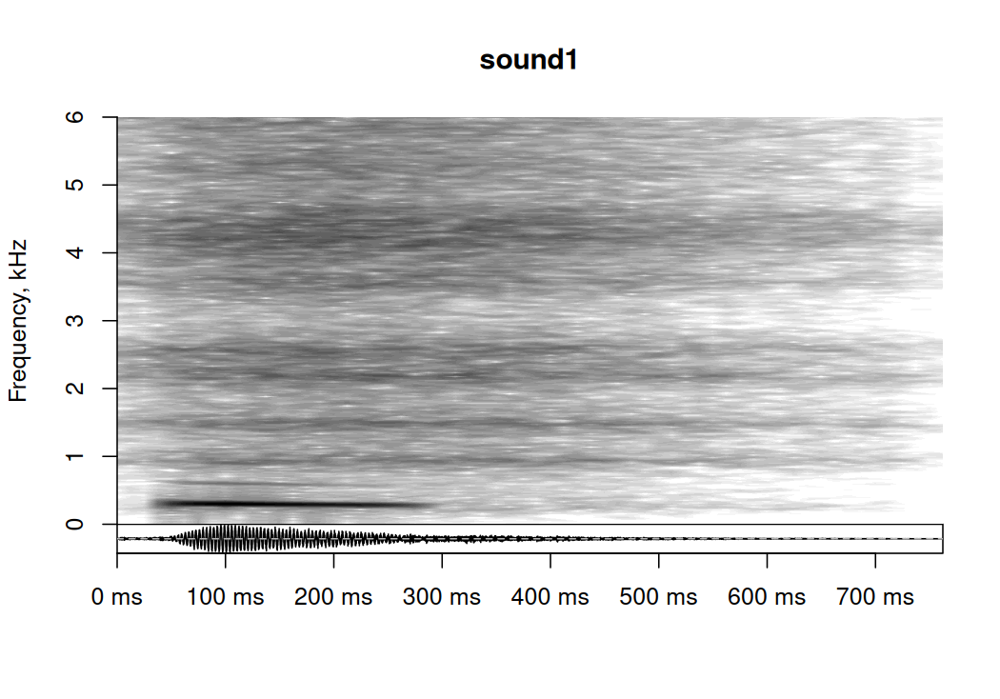
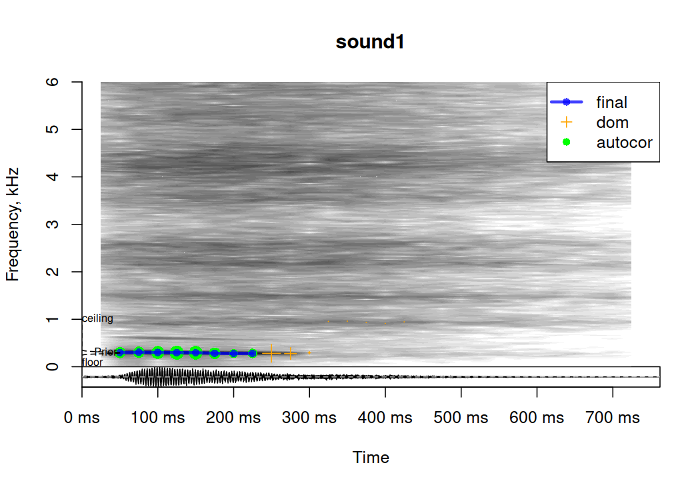

<!-- README.md is generated from README.Rmd. Please edit that file -->

Parametric source-filter synthesis of harmonic-noise signals, such as
animal vocalizations and human voice, with control over pitch, formants,
noise, amplitude modulation, nonlinear phenomena, and morphing. General
signal processing tools for audio analysis and manipulation: pitch
tracking, formant and vocal tract length estimation, reassigned and
auditory spectrograms, modulation spectra and psychoacoustic roughness,
self-similarity and surprisal, audio segmentation, pitch and formant
shifting, etc. Includes four interactive web apps for audio synthesis,
annotation, formant analysis, and manually correcting pitch contours.

# Key functions

## Visualization

- `spectrogram` Ordinary (STFT) spectrograms
- `audSpectrogram` Auditory spectrograms
- `modulationSpectrum` Modulation spectra and roughness (see Anikin
  2025)
- `ssm` Self-similarity matrices, acoustic novelty (see Anikin 2026)
- `phasegram` Nonlinear analysis, phasegrams (see Anikin & Herbst 2025)

## Acoustic analysis

- `analyze` General-purpose acoustic analysis (extracts nearly
  everything: spectral descriptives, pitch, formants, loudness,
  roughness, …)
- `segment` Audio segmentation, analysis of rhythm and temporal
  structure of sequences
- `getSurprisal` Shannon and autocorrelation-based surprisal, Bayesian
  surprise (see Anikin 2026)
- `estimateVTL`, `schwa` Formant analysis (see Anikin et al. 2024)

## Interactive acoustic analysis

- `pitch_app` Manually corrected formant measurement
- `formant_app` Manually corrected pitch tracking
- `annotation_app` Audio annotation

## Sound synthesis

- `soundgen` The main function for sound and voice synthesis (see Anikin
  2019)
- `soundgen_app` Interactive version of the `soundgen()` function
- `morph` Morphing of two sounds based on their soundgen code

## Sound modification

- `normalizeFolder` Peak / RMS etc normalization of recordings
- `timeStretch`, `shiftPitch`, `prosody`, `shiftFormants` Selective
  modification of fundamental frequency, duration, and/or resonance
  frequency
- `noiseRemoval`, `compressor`, `addAM`, `resample`, etc: various audio
  effects

## Vignettes

- <https://cogsci.se/soundgen/spectrograms.html>
- <https://cogsci.se/soundgen/sound_generation.html>
- <https://cogsci.se/soundgen/acoustic_analysis.html>
- <https://cogsci.se/soundgen/matching/matching.html>

## References

- Anikin, A. (2019). Soundgen: an open-source tool for synthesizing
  nonverbal vocalizations. Behavior Research Methods, 51(2), 778-792.
- Anikin, A., Barreda, S. & Reby, D. (2024) A practical guide to
  calculating vocal tract length and scale-invariant formant patterns.
  Behavior Research Methods 56, 5588–5604.
- Anikin, A. (2025) Acoustic estimation of voice roughness. Attention,
  Perception, & Psychophysics 87: 1771–1787.
- Anikin, A. & Herbst, C.T. (2025) How to analyze and manipulate
  nonlinear phenomena in voice recordings. Philosophical Transactions B
  380: 20240003.
- Anikin, A. (2026) Measuring surprisal in sound sequences. Behavior
  Research Methods.

# Example of sound synthesis

Use the `soundgen()` function to create a breathy moan:

    s = soundgen(
      sylLen = 230,               # duration of voiced part, ms
      pitch = c(305, 280),        # pitch, Hz (goes down from 305 to 380 Hz)
      ampl = c(0, -20),           # amplitude, dB (gradual fade-out by 20 dB)
      rolloff = -30,              # strong f0, weak harmonics
      temperature = 0.05,         # some stochasticity in generation
      formants = c(260, 960, 1500, 2200,  # F1-F8 formant frequencies, Hz
                   2600, 3600, 4200, 4500),
      noise = data.frame(
        time = c(-50, 120, 700),  # time of noise anchors
        value = c(-25, -15, -40)   # noise amplitude, dB
      ),
      rolloffNoise = 0,           # flat noise spectrum before adding formants
      addSilence = 0, samplingRate = 44100, pitchSamplingRate = 44100,
      plot = TRUE, osc = TRUE, ylim = c(0, 6)
    )

<audio controls style = "display: block">
<source src="man/figures/s.mp3" type="audio/mp3">
</audio>

# Example of acoustic analysis

Use the `analyze()` function to detect pitch and obtain other spectral
descriptives of the sound we have just synthesized:

    a = analyze(s, 44100, plot = TRUE, ylim = c(0, 6))
    #> The sound is too short to be analyzed with amRes = 1 Hz. Actual amRes ~=  1.31

    a$detailed[1:5, c('time', 'pitch', 'HNR', 'ampl', 'loudness')]
    #>        time    pitch       HNR       ampl  loudness
    #> 1  25.00000       NA        NA 0.03313867  6.039053
    #> 2  49.98866 298.2525  5.656488 0.18586389 14.131545
    #> 3  74.97732 304.5555 15.080634 0.41149933 23.273527
    #> 4  99.96599 300.9743 17.070995 0.53578982 27.618641
    #> 5 124.95465 296.9162 14.551249 0.49568060 26.568438
    colnames(a$detailed)
    #>  [1] "duration"           "duration_noSilence" "time"               "amEnvDep"          
    #>  [5] "amEnvDepVoiced"     "amEnvFreq"          "amEnvFreqVoiced"    "amEnvPurity"       
    #>  [9] "amEnvPurityVoiced"  "amMsFreq"           "amMsFreqVoiced"     "amMsPurity"        
    #> [13] "amMsPurityVoiced"   "ampl"               "ampl_noSilence"     "amplVoiced"        
    #> [17] "CPP"                "dom"                "domVoiced"          "entropySh"         
    #> [21] "entropyShVoiced"    "entropyW"           "entropyWVoiced"     "epoch"             
    #> [25] "f1_freq"            "f1_width"           "f2_freq"            "f2_width"          
    #> [29] "f3_freq"            "f3_width"           "fluctuation"        "fluctuationVoiced" 
    #> [33] "flux"               "fmDep"              "fmFreq"             "fmPurity"          
    #> [37] "harmEnergy"         "harmHeight"         "HNR"                "HNRVoiced"         
    #> [41] "loudness"           "loudnessVoiced"     "novelty"            "noveltyVoiced"     
    #> [45] "peakFreq"           "peakFreqVoiced"     "pitch"              "quartile25"        
    #> [49] "quartile25Voiced"   "quartile50"         "quartile50Voiced"   "quartile75"        
    #> [53] "quartile75Voiced"   "roughness"          "roughnessVoiced"    "sharpness"         
    #> [57] "sharpnessVoiced"    "specCentroid"       "specCentroidVoiced" "specSlope"         
    #> [61] "specSlopeVoiced"    "subDep"             "subRatio"           "voiced"
